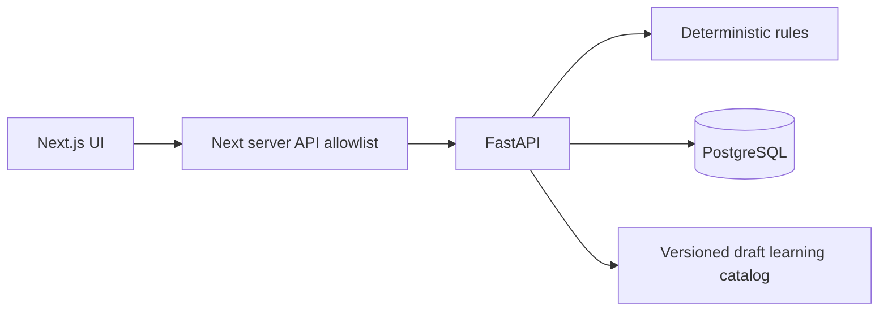

# План интеграции AntiDrop

11 октября 2026, Europe/Moscow. Контрольная точка A **согласована пользователем** в чате: «Да, интегрируй по этому плану». Позднее пользователь явно разрешил завершить merge в одну ветку, удалить остальные, закоммитить всё и подготовить README для самостоятельного развёртывания. Это разрешение охватывает точки B/C; итоговая ветка — `master`. Перед удалением сохраняются recovery tags и проверяются свежие remote tips.

## База и порядок

База `frontend-test-brach@8bdec6c`: утверждённые Next.js shell/overview, CSS Modules/BEM, Onest, навигация и экранные тесты. Отдельный worktree `D:\FintechPSD\anti-drop-unified`, ветка `integration/antidrop-unified`.

1. Выборочный перенос backend `backend-antidrop-postgres@0fb475f`: domain/contracts, PostgreSQL/psycopg3/SQLAlchemy, server identity, Alembic, tests, infrastructure, competition evidence. Frontend и его документацию backend-версией не заменять.
2. Учебная функция отдельно подготовлена в `feature/learning-server@b032ae4` и `feature/learning-cards@6806023`; перенос catalog/progress/grades/rewards и интерфейса.
3. P1 `zima@19162ec`, исправленный sink из `master@f6c6c7c`: локализация, communication/advisory с auth, experiments/finance/evaluation и 81 synthetic episodes. Исправить subject leakage; неподдержанную ablation обозначить NOT RUN.
4. Allowlisted Next API/BFF, серверные demo credentials, persistent browser case journey, Compose frontend, readiness, CI.
5. Полный backend/PG/browser/build/security review, clean startup и README перед публикацией в master.
6. Архивные refs, проверка remote tips, затем разрешённое пользователем удаление остальных веток без удаления worktrees или данных.

## Целевая архитектура

Root Python layout сохранён: перенос в `app/` не даёт необходимой продуктовой пользы и затрудняет сохранение approved frontend. Одна поддерживаемая FastAPI entrypoint `main:app`, один Next frontend, одна PostgreSQL БД. Legacy static app сохранена как compatibility/demo; stdlib fallback не является persistent demo.

## Решения о функциях

Сохранить: risk analysis, strict snapshots, neutral alerts, legacy content/quiz/phone trainer, owned durable evaluations/cases, educational source PDF, локализацию RU/UZ с draft status, optional advisory, offline experiments/finance/evaluation.

Заменить: unscoped memory/SQLite/psycopg2 cases — authenticated PostgreSQL; `/api/cases` возвращает documented 410. Browser support подключён к versioned sandbox через Next BFF. Не переносить raw-header identity или ошибочную реализацию users/SIM persistence. Учебный phone trainer сохранён, банковские действия не добавлены.

Отложить явно: operator runtime/status transitions из P1, поскольку память/JSONL и loopback без auth несовместимы с принятым контрактом. Источники и recovery refs сохранены, требования описаны в P1_PRESERVATION.md. Это ограничение частичной интеграции, не удаление веток или заявление о сохранённом операторском flow. Case-linked P1 event refs до адаптации отвергаются.

Учебный прогресс отделён от risk score. Все посетители локального стенда используют один явно подписанный synthetic profile; это не полноценная система банковской аутентификации. Сервер определяет subject, дату Москвы, grade, XP, streak и reward. Балльные награды 3/7/14/30 разовые; категория выдаётся один раз за каждый заработанный календарный месяц, всё виртуальное; percentile отсутствует без реальной выборки. Заморозка серии пока не реализована.

## Риски и rollback

Существующую legacy master-БД не мигрировать на новую схему автоматически: одноимённые tables отличаются. Fresh isolated PostgreSQL — проверяемый путь; импорт старых данных требует отдельного mapping/backup plan. Applied root revision не переписывать.

Recovery tags опубликованы: `recovery/2026-10-11/{frontend,backend,master,zima,my-branch,learning-cards,learning-server,unified}`. Единственная рабочая ветка — master; остальные удалены по явному разрешению пользователя, исходные worktrees и patch сохранены. Откат приложения — checkout проверенного commit/tag в отдельном worktree; откат БД — восстановление проверенного backup в новую БД, без удаления существующего volume. Не использовать destructive reset или force push.

Согласованные gates: unit/PG concurrency/ownership/rollback/restart/migrations, TS/lint/build, Playwright desktop/mobile/API/failure, Compose startup/runtime role, source/license/config/secret review. Фактические результаты — QUALITY_REPORT.md, предполагаемые результаты не считать PASS.
